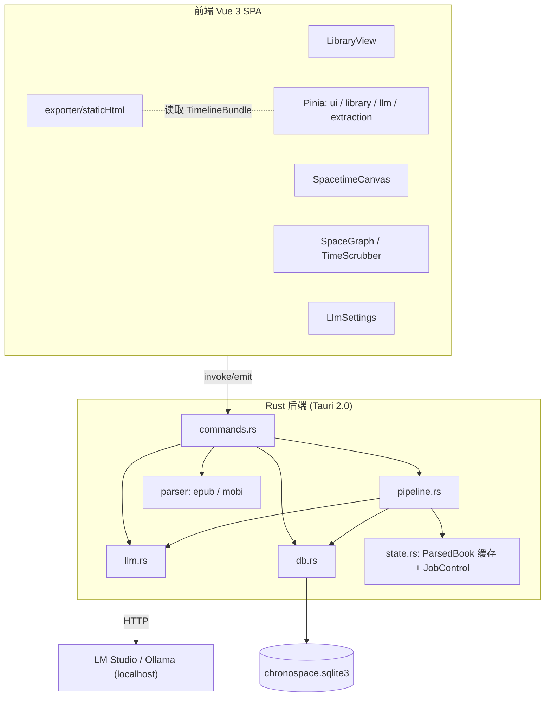
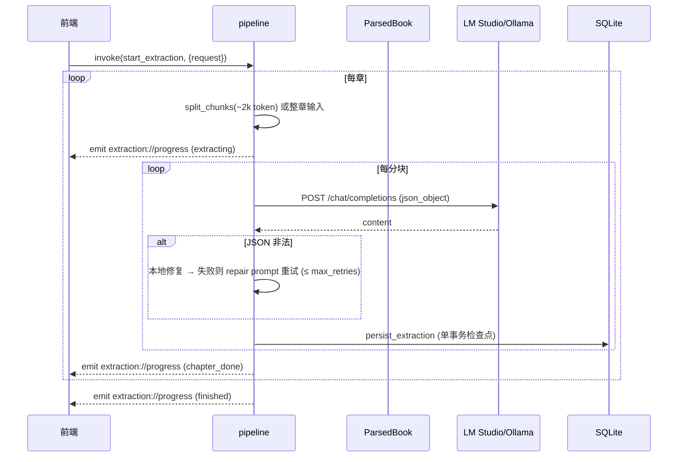
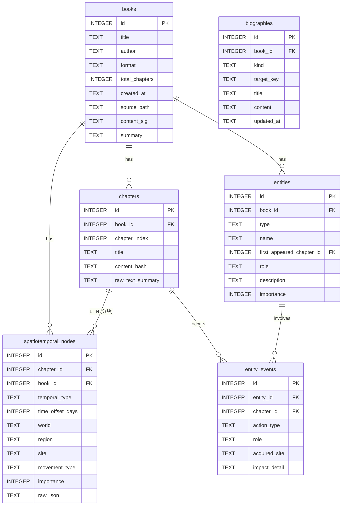
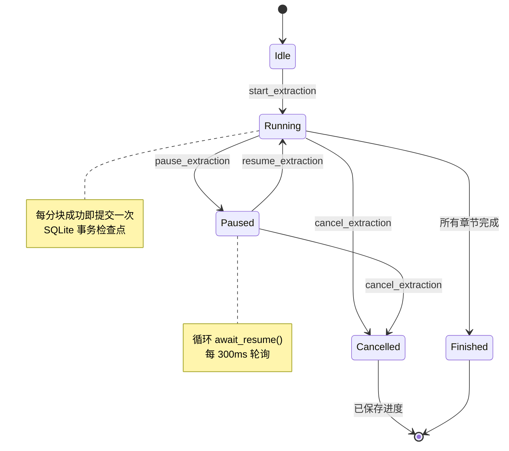

# ChronoSpace Reader · 架构设计蓝图（design.md）

> 当前版本：**v0.1.43**
> 本文档描述系统架构、数据流、SQLite 关系模式、状态机、协议契约与 UI 组件层级，并与代码库保持同步。

---

## 1. 设计目标与约束

| 目标 | 说明 |
| --- | --- |
| 本地优先 | 全部计算（解析、抽取、可视化、导出）在本机完成，不联网上传 |
| 内存解析 | 电子书原文仅驻留内存，结构化结果才落 SQLite，避免磁盘膨胀 |
| 本地 LLM | 通过 OpenAI 兼容协议对接 LM Studio / Ollama，强制 JSON 输出并默认关闭思考模式 |
| 结构可靠 | 严格 JSON Schema + 本地修复 + 有限次重试，容忍小模型输出抖动 |
| 可续跑 | 逐章事务检查点，支持暂停/继续/取消与断点续跑 |
| 可视化 | 时间 × 空间矩阵（人物轨迹 + 关系连线）+ 双轴时间线 + 实体谱系 |
| 可发布 | 一键导出零依赖单页 HTML，适配 GitHub Pages |

**技术栈**：Tauri 2.0（Rust 2021）、Vue 3（`<script setup lang="ts">`）、Vite、Pinia、TailwindCSS、Font Awesome、rusqlite（bundled）、reqwest（rustls）。静态导出页通过 CDN 引入 Cytoscape.js。

---

## 2. 分层架构



### 2.1 模块职责

| 模块 | 职责 |
| --- | --- |
| `parser/` | 格式探测、内存解析、分章、纯文本化（去标签、实体解码） |
| `parser/encoding` | 中文友好解码：BOM 检测、可靠 Unicode 声明、候选（UTF-8 / GBK / windows-1252）可读性打分；纠正「GBK 字节被误标为 windows-1252」 |
| `llm.rs` | OpenAI 兼容客户端：模型探测、`chat/completions`、JSON 模式、思考模式关闭 |
| `pipeline.rs` | 分块、提示词、调用、JSON 修复与重试、事务持久化、进度事件 |
| `db.rs` | 迁移、CRUD、聚合查询（`timeline_bundle`） |
| `state.rs` | `ParsedBook` 内存缓存、`JobControl`（暂停/取消）、LLM 配置 |
| `commands.rs` | Tauri 命令边界，参数校验与错误映射 |

---

## 3. 数据流

### 3.1 导入（Ingest）

```mermaid
sequenceDiagram
  participant U as 用户
  participant FE as 前端
  participant CMD as commands.ingest_book
  participant PAR as parser
  participant DB as SQLite
  participant MEM as ParsedBook 缓存
  U->>FE: 拖入 / 选择文件
  FE->>CMD: invoke(ingest_book, {path})
  CMD->>CMD: tokio::fs::read(path) 读入内存
  CMD->>PAR: parse_book(filename, bytes)
  PAR->>PAR: detect_format → epub/mobi
  PAR-->>CMD: ParsedBook { chapters }
  CMD->>DB: insert_book / insert_chapter*
  CMD->>MEM: cache_book(book_id, ParsedBook)
  CMD-->>FE: IngestResult
```

### 3.2 抽取（Extract）



### 3.3 导出（Export）

- **HTML**：前端读取 `timeline_bundle` → `exporter/staticHtml.ts` 生成内联 JSON 的单页 HTML。
- **总览 JSON**：`exporter/summary.ts` 汇总全书总览、逐章摘要、章节时间/空间、本章人物、人物、地点、物品与事件。
- **总览 CSV**：仅导出章节行（分号分隔、UTF-8 BOM、自动转义），包含时间/空间与本章人物列。
- 三种格式均由 `plugin-dialog.save` 选择路径，再调用 Rust `write_text_file` 落盘，避免前端 fs 插件的路径权限限制。

---

## 4. SQLite 关系模式



- 唯一约束：`chapters(book_id, chapter_index)`、`entities(book_id, type, name)`。
- 外键均带 `ON DELETE CASCADE`（`entities.first_appeared_chapter_id` 为 `SET NULL`）。
- `PRAGMA journal_mode=WAL`、`foreign_keys=ON`、`synchronous=NORMAL`。
- 迁移策略：全部语句使用 `CREATE TABLE IF NOT EXISTS` / `CREATE INDEX IF NOT EXISTS`，可幂等重复执行。
- 存储位置：由 `paths.rs` 解析为用户配置目录下的 `local/<APPNAME>`（Linux `~/.config/local/chronospace-reader/`，macOS `~/Library/Application Support/local/chronospace-reader/`，Windows `%APPDATA%\local\chronospace-reader\`），可用 `CHRONOSPACE_DATA_DIR` 覆盖。数据库文件 `chronospace.sqlite3`；同样的目录保存 `llm_config.json`。原文不落盘，仅驻内存。
- 一个章节可对应**多个** `spatiotemporal_nodes`（分块抽取），画布查询取每章最早节点作为代表。
- **并发**：`ExtractionRequest.concurrency`（1–4）控制 `run_extraction` 的滑动窗口：以 `tokio::task::JoinSet` 始终保持最多 N 个章节任务，完成一个立即补位；某个章节的 JSON 重试只占用一个槽位，不会阻塞整批。DB 写入由 `Mutex<Connection>` 串行化。引擎需支持并行/批处理才能真正加速。
- **重抽覆盖**：`skip_extracted=false` 时 `run_extraction` 先调用 `clear_book_extraction`（删除该书 `spatiotemporal_nodes` / `entity_events` / `entities` 并清空章节摘要），再重新处理，避免重复数据；前端在开始前弹出确认。

---

## 5. 抽取 JSON Schema 契约（v1）

每个分块的模型输出必须是如下 JSON 对象（与 `models.rs::SegmentExtraction`、`types/schema.ts` 一一对应）：

```json
{
  "chapter_index": 12,
  "chapter_title": "七玄深谷",
  "narrative_perspective": "first_person",
  "temporal": {
    "type": "CONTINUOUS | JUMP_FORWARD | FLASHBACK | UNCERTAIN",
    "raw_marker": "三年后 / 眨眼数日",
    "relative_delta_days": 1095,
    "reference_anchor": "上一事件描述"
  },
  "spatial": {
    "world": "原文明确给出的世界/位面名；未给出则空字符串，不填“现实世界”等泛化标签",
    "region": "越国",
    "site": "神手谷",
    "movement_type": "STAY | LOCAL_MOVE | TELEPORT | ASCENSION | DUNGEON_ENTER | DUNGEON_EXIT",
    "source_site": "七玄门宗门广场",
    "importance": 4
  },
  "characters": [
    { "name": "墨大夫", "action": "FIRST_APPEARANCE | ACTIVE | DEPARTURE | DEATH", "role": "师尊/对手", "description": "面色青黄的老者", "importance": 4 }
  ],
  "items_and_skills": [
    { "name": "掌天瓶", "category": "ITEM | SKILL | LEGACY", "importance": 5, "acquired_from": { "spatial": "神手谷后山草丛", "temporal": "入夜时分" }, "usage_in_chapter": "拾取并藏匿", "future_hook_flag": true }
  ],
  "plot_summary": "一句话核心剧情摘要"
}
```

**鲁棒性策略**（`pipeline::parse_extraction`）：

1. `extract_json_block`：截取首个 `{` 到末个 `}`，容忍前后缀文本与 Markdown 代码块。
2. `repair_json_text`：剔除 `/* */` 与 `//` 注释、去除尾随逗号。
3. `normalize_value`：补齐缺失数组、剔除缺 `name` 的条目；逐条修正非法枚举（action/category/movement/temporal/perspective）、把数字/布尔等字符串字段降级为字符串、容错 `importance` 与 `future_hook_flag`，避免一条格式错误导致整段人物/物品被丢弃。
4. 严格反序列化失败时 `lenient_extraction` 兜底，按数组元素逐条解析、保留可识别字段。
5. 仍失败则携带解析错误、上一次输出与原始任务，用修复提示词让模型只修 JSON 语法、补全截断结构并保留原字段/值，次数 = `LlmConfig.max_retries`（默认 3）。

**实体校验**：`ground_entries` 会先做直接子串匹配，再忽略空格与 `· • ・ - _` 等分隔符后匹配，避免「久木 祥一郎」这类带空格的人名被误删；仍不在正文中的条目才会丢弃。

**精简提示词**：抽取系统提示词只保留字段规则、紧凑 JSON 模板和输出前检查清单；用户提示只保留正文边界与关键要求（人物覆盖、site 非空、完整闭合）；修复提示只给解析错误、上次输出和原任务。输出要求短字段、紧凑格式、完整闭合，过长时压缩描述而不是截断。全书总览提示同样精简，失败时切换为纯文本重试。

**思考模式**：所有 chat 请求默认带 `reasoning_effort: "none"`，关闭 LM Studio / Ollama 中支持思考模型的推理输出，避免推理 token 挤占 JSON 输出预算；模型名包含 `qwen` 时还会在用户消息末尾追加 `/no_think`，兼容 Qwen3 的软开关。若引擎返回 400/404/422 表示不支持该字段，则去掉它重试；若仍因 `response_format` 失败，再降级为普通 JSON 提示。

**视角归一化**：系统提示词要求判断 `first_person` / `third_person`；第一人称时把「我」解析为主角规范名，无法确定则使用 `PROTAGONIST_FIRST_PERSON` 并在 `description` 注明别名。

**人物覆盖与重要度**：提示词要求尽可能列出本段所有具名人物（含次要/仅被提及者），同一人物的绰号/尊称归并到规范名；明确要求排除作者、译者、序言作者等现实身份，以及无名群体和代词。每个分块给出 `importance`（1–5），持久化时取较强值；前端再按**全书范围**用「模型判断 50% + 章节覆盖率 + 出场频率 + 时间跨度」汇总为最终 1–5 级并排序。作者署名与“作者”占位条目在 `get_entities` 查询中排除。

**空间与物品重要度**：空间节点与物品/功法条目同样输出 1–5 的 `importance`。前端按全书汇总：空间用「模型判断 + 覆盖章节 + 事件频率 + 跨度 + 出场人物丰富度」，物品/功法用「模型判断 + 覆盖章节 + 出现频率 + 跨度」；模型分缺失的旧数据自动退化为纯统计公式。空间/物品表按重要度降序，并支持“仅重要”过滤。

**空间来源**：`world/region/site` 只允许来自原文；提示词要求只要正文出现场所就必须填写 `site`，不能因为上级区域不确定而留空，也不再注入“现实世界/某城市”等提示词占位值。展示层会将旧数据中的“现实世界”“未知空间”等泛化标签视为空（`utils/space.ts`）；空间重要度表会跳过完全未识别到空间的章节，只在页头显示数量，避免“未标注空间”吞掉全书统计。

**题材无关与抗幻觉**：提示词不预设作品类型、不包含任何示例专有名词（避免小模型照搬示例造成「奇怪的人」）；`world/region/site` 也只取原文明确写出的名称，不强制“界”类术语，也不补“现实世界/某城市”等泛化标签。抽取后由 `ground_entries` 按当前分块正文校验：人物/物品名若非本段正文子串则丢弃（`PROTAGONIST_FIRST_PERSON` 与单字名豁免），过滤数量通过日志事件上报。

**章题提取**：EPUB 章节优先读取正文 `h1/h2/h3`，并对“卷名 vs 章名”按标题形态打分（`第X章/回/节` 优先于 `第X卷/部/篇`）；`<title>` 仅在无正文标题时使用，且会剔除纯书名或“书名 - 章名”中的书名部分。MOBI/无目录场景用 `guess_title_with_book` 跳过书名行。旧数据在重新加载源文件时由 `repair_titles_if_unsplit` 自动修正。

**全书总览**：整本书全部章节成功后，按章节摘要生成 `books.summary`。章节摘要总长超过 5000 字时先分批生成阶段摘要，再汇总为 300–500 字总览；**最终总览与所有阶段摘要按顺序拼接后存入 `books.summary`**，前端限制面板高度并在内部滚动展示。分批与最终汇总都会通过 `summarizing` 进度事件上报步骤。失败只记日志，不影响抽取结果。输出会校验有效字数，若模型只返回“...”“……”等占位符，则自动改用纯文本提示重试一次。旧数据可通过 `generate_book_summary` 手动生成，该命令只读数据库中的章节摘要，不要求源文件仍在原路径。

---

### 5.1 中文与编码处理

- **解析层**（`parser::encoding::smart_decode`）：BOM → 可靠 Unicode 声明 → 候选打分（CJK 字符加分、替换符/控制符扣分），支持 UTF-8 / GBK / GB18030 / Big5。MOBI 头的 `textEncoding` 数值映射为编码名，`1252` 或未知值交由启发式判定，从而纠正中文书中「GBK 字节被误标为 windows-1252」的常见问题。EPUB 章节按 XML prolog 的 `encoding="..."` 声明解码（`sniff_xml_encoding`）。
- **抽取层**：系统提示词要求所有自然语言字段输出**简体中文**，仅 JSON 键名与机器枚举（`CONTINUOUS`、`FIRST_APPEARANCE`、`ITEM` 等）保持英文；专有名词保留原作写法。
- **展示层**：界面与导出页使用中文无衬线字体栈（Noto Sans SC / 苹方 / 微软雅黑）。

### 5.2 合订本检测与拆分

一个 EPUB 文件可能包含多本书（合集/合订本）。流程为「**先探查、再确认选择、后导入**」：

```mermaid
sequenceDiagram
  participant FE as 前端
  participant CMD as commands
  participant PAR as parser::epub
  FE->>CMD: inspect_book(path)
  CMD->>PAR: parse_book → candidates
  PAR-->>CMD: BookCandidate[]（目录树：合集/书/章节）
  CMD-->>FE: BookInspection { suspected_multi_book, candidates }
  alt suspected_multi_book
    FE->>FE: 弹出对话框，按层级或任意节点勾选
    FE->>CMD: ingest_book(path, splitIntoBooks, candidateIds)
    CMD->>PAR: split_book_selected / split_book
    CMD->>CMD: 逐本 insert_book + insert_chapter + cache
    CMD-->>FE: IngestResult[]
  else 单本
    FE->>CMD: ingest_book(path, false)
  end
```

- **探测信号**：解析 EPUB3 `nav.xhtml`（`epub:type="toc"`）或 EPUB2 `toc.ncx` 的 `navMap` 顶级分组；每个顶层节点通过其 `href` 子树映射到 spine 章节区间。当 ≥2 个顶层节点，或单个顶层节点包含 ≥2 个带下级的子书/标题为“全集/合集/套装”等时，判定疑似合订本。
- **候选结构**：`BookCandidate { id, title, start_index, end_index, chapter_count, depth, children }` 递归保存目录树；`id` 为稳定路径（如 `0.1`），支持在任意层级选择合集、书或章节组。
- **拆分语义**：`split_book_selected` 只导入用户勾选的节点区间，节点下的所有后代自动成为该书的章节，并**重排 `chapter_index`**（每本从 0 起）；父子节点同时被选中时只保留父节点。全选顶层时走 `split_book`，未被覆盖的章节归入《原书名 · 其他》，避免正文丢失。
- **确认契约**：`inspect_book` 只读探查、不落库；`ingest_book(splitIntoBooks, candidateIds)` 才真正写库并缓存到 `AppState.books`（每本独立缓存）。
- **UI**：`MultiBookDialog.vue` 使用递归 `BookCandidateNode.vue` 展示目录树、章节区间、下级数量与已选统计；支持「按层级全选 / 清空 / 导入选中 / 作为单本导入 / 取消」。MOBI/AZW3 暂不做多本探测（无结构化目录）。

---

## 6. IPC 协议契约（Tauri Commands）

| 命令 | 入参 | 出参 | 说明 |
| --- | --- | --- | --- |
| `inspect_book` | `path: string` | `BookInspection` | 导入前探查，判断是否疑似合订本 |
| `ingest_book` | `path: string, splitIntoBooks?: boolean, candidateIds?: string[]` | `IngestResult[]` | 读文件入内存并解析落库；可按选中的目录节点拆分 |
| `list_books` | — | `BookRow[]` | 书库列表（含抽取进度） |
| `get_timeline` | `bookId: number` | `TimelineBundle` | 画布聚合数据 |
| `delete_book` | `bookId: number` | `void` | 级联删除 |
| `clear_all_data` | — | `void` | 清空全部书籍与抽取数据（含内存缓存） |
| `set_book_source` | `bookId: number, path: string, force?: boolean` | `SourceCheck` | 重新定位源文件并校验签名 |
| `get_book_source` | `bookId: number` | `string \| null` | 读取记录的源文件路径 |
| `save_llm_config` | `config: LlmConfig` | `void` | 写入状态与磁盘 |
| `get_llm_config` | — | `LlmConfig \| null` | 读取配置 |
| `list_models` | `config: LlmConfig` | `ModelInfo[]` | `/v1/models`（Ollama 回退 `/api/tags`） |
| `list_loaded_models` | `config: LlmConfig` | `ModelInfo[]` | 引擎中已加载模型（Ollama `/api/ps`、LM Studio `/api/v0/models`） |
| `activate_model` | `config: LlmConfig` | `string` | 卸载旧模型并预热加载当前模型（尽力而为），返回状态说明 |
| `test_connection` | `config: LlmConfig` | `boolean` | 连通性探测 |
| `gpu_status` | `config: LlmConfig` | `GpuStatus` | 显存占用与建议并发数（`nvidia-smi` + Ollama `/api/ps`，尽力而为） |
| `start_extraction` | `request: ExtractionRequest` | `ChapterExtractionResult[]` | 批量抽取；全部成功后自动生成全书总览 |
| `generate_book_summary` | `bookId: number, config: LlmConfig` | `string` | 为已有抽取数据手动生成/刷新全书总览；分批进度通过事件推送 |
| `list_biographies` | `bookId: number` | `BiographyKey[]` | 已生成传记的 kind/key 索引 |
| `get_biography` | `bookId, kind, targetKey` | `BiographyRow \| null` | 读取单条传记 |
| `generate_biography` | `bookId, kind, targetKey, config` | `BiographyRow` | 本地模型生成/重生成传记（≤2000 字） |
| `pause_extraction` / `resume_extraction` / `cancel_extraction` | `bookId: number` | `void` | 任务控制 |
| `read_text_file` | `path: string` | `string` | 辅助读取 |
| `write_text_file` | `path: string, content: string` | `void` | 导出写入（HTML / JSON / CSV），Rust 侧直接落盘 |

> Tauri v2 自动将 JS 侧 `camelCase` 参数映射为 Rust `snake_case`。

### 6.1 事件契约（后端 → 前端 emit）

- `extraction://progress` → `ProgressEvent { book_id, phase, current, total, chapter_index, chapter_title, message, retries }`
  - `phase ∈ { extracting, paused, skipped, chapter_done, finished, cancelled }`
- `extraction://log` → `LogEvent { book_id, message }`（按书籍路由的人类可读日志行）

### 6.2 错误契约

所有命令返回 `Result<T, AppError>`，`AppError` 序列化为：

```json
{ "code": "LLM_ERROR", "message": "无法连接引擎 http://localhost:1234/v1/models: ..." }
```

`code ∈ { DB_ERROR, PARSE_ERROR, UNSUPPORTED_FORMAT, LLM_ERROR, JSON_REPAIR_ERROR, SOURCE_MISSING, SOURCE_MISMATCH, IO_ERROR, SERDE_ERROR, INTERNAL_ERROR }`。

**源文件重定位**：`books.source_path` / `books.content_sig` 记录源文件与其 SHA-256 签名。抽取开始时若内存无原文，`ensure_book_loaded` 按路径重新解析并校验签名；缺失返回 `SOURCE_MISSING`、不匹配返回 `SOURCE_MISMATCH`，前端据此提示重新选择文件（可用 `set_book_source(..., force)` 强制关联）。

---

## 7. 抽取管线状态机



`JobControl` 以 `AtomicBool`（`paused` / `cancelled`）实现，注册于 `AppState.jobs`，任务结束后清除。

**多本并发**：`AppState.jobs` 以 `book_id` 为键，因此可同时运行多本抽取；前端亦以 `bookId` 维护独立的 `BookJob`（`jobs` 映射），进度/日志事件按 `book_id` 路由。因此可暂停 A 本并同时开始抽取 B 本，两者互不影响。进度事件 `ProgressEvent.book_id` 与日志事件 `LogEvent.book_id` 用于路由。

---

## 8. 前端状态与组件层级

```
App.vue
├── header (导航 + 引擎状态)
├── Sidebar.vue              书库列表 / 抽取进度 / 完成与抽取中状态
├── main
│   ├── LibraryView.vue      导入区 · 统计 · ExtractionRunner · 藏书卡片(总览/抽取/画布/导出/删除)
│   │   └── ExtractionRunner.vue   开始/暂停/继续/取消 · 进度条 · 日志
│   ├── SpacetimeCanvas.vue
│   │   ├── SpaceGraph.vue          时间 × 空间矩阵：横轴章节、每行一个地点；人物首现圆点 + 跨时空轨迹 + 关系虚线 + 当前行高亮 + 缩放控件
│   │   └── TimeScrubber.vue        章节轴 + 虚拟时间线双滑块 + 当前章节信息
│   ├── SummaryView.vue       总览：全书总览 + 逐章摘要 + 统计 + 本章主要人物/首现人物/时空标签（点击书籍默认进入）
│   ├── RelationGraph.vue     人物总览表：全书重要度排序，含首现/最近出场、主要活动地、同章共现区间；排除作者
│   ├── EntityCards.vue       空间 / 物品总览表：全书重要度、事件数、最近章节、关联人物/物品与获得章节
│   ├── EntityDetailDialog.vue 人物/地点/物品详情：传记、元数据、垂直时间线三个标签页；按需生成/重生成传记
│   └── LlmSettings.vue       引擎选择 · 模型探测 · 参数 · 连接测试 · 数据管理
├── ConfirmDialog.vue         全局确认框（ui.askConfirm）
└── ToastHost.vue             全局通知
```

### Pinia Store

| Store | 关键状态 | 关键动作 |
| --- | --- | --- |
| `ui` | `activeView`, `toasts` | `setView`, `toast`, `dismiss` |
| `library` | `books`, `activeBookId`, `timeline` | `refresh`, `ingest`, `open`, `reloadTimeline`, `remove` |
| `llm` | `config`, `models`, `connected` | `applyEngine`, `load`, `persist`, `fetchModels`, `test` |
| `extraction` | `jobs: Record<bookId, BookJob>`（每本独立 `running`/`paused`/`progress`/`logs`/`results`） | `attach`, `start(bookId)`, `pause/resume/cancel(bookId)` |

---

## 9. 静态 HTML 导出器

`exporter/staticHtml.ts::buildStaticHtml(bundle)` 生成单文件：

- 内联 `TimelineBundle` JSON（`<` / `-->` 转义，避免脚本注入）。
- 通过 CDN 引入 Cytoscape.js，其余样式与逻辑全部内联（无其他外部依赖）。
- 视图：拓扑空间图（按 `world` 复合分组）+ 章节/虚拟时间双滑块 + 人物/物品谱系侧栏。
- 点击实体追溯其事件章节，并聚焦/高亮对应空间节点。

---

## 10. 错误处理与降级

| 场景 | 处理 |
| --- | --- |
| 无法识别格式 | `UNSUPPORTED_FORMAT`，提示仅支持 EPUB/MOBI/AZW3 |
| DRM / HUFF-CDIC | `UNSUPPORTED_FORMAT`，明确提示不支持 |
| 模型输出非法 JSON | 平衡括号提取 + 本地修复（去注释/尾随逗号、转义裸控制字符）→ 修复提示词重试（≤3） → `JSON_REPAIR_ERROR` |
| 字符串内裸控制字符 | `escape_control_chars_in_strings` 将 `\n`/`\r`/`\t`/`\u00XX` 转义，修复 `control character found` 错误 |
| 缺少逗号 | `MISSING_COMMA_RE` 在「值 + 下一个键」之间补逗号，修复 `expected , or }` |
| 输出被截断 | `balance_braces` 依据未闭合括号补齐 `}` / `]` |
| 推理模型空 content | 回退读取 `reasoning_content` / `reasoning` |
| 引擎不支持 `reasoning_effort` | 去掉思考控制重试；再按需去掉 `response_format` |
| 引擎不支持 `response_format` | 自动降级为不带该字段重试一次 |
| 引擎不可达 | `LLM_ERROR`，提示启动本地服务 |
| 抽取中断/取消 | 已完成章节的事务检查点保留，可续跑 |
| 非 Tauri 环境 | 前端 `api` 层守卫，返回明确错误提示 |

---

## 11. 版本与文档同步规则

- 版本源：`package.json`、`src-tauri/Cargo.toml`、`src-tauri/tauri.conf.json`。
- `scripts/bump-version.mjs` 同步三处并替换文档中的 `vX.Y.Z`。
- `scripts/docs-check.mjs` 校验一致性（可接入 CI）。
- 每个有意义的功能/修复递增 **PATCH**，提交遵循 **Conventional Commits**：

```
feat(core): implement epub parser in memory and sqlite schema v0.1.1
feat(llm): add lm studio open-ai compatible client with retry v0.1.2
feat(export): generate standalone single-page html bundle v0.1.3
docs: update README.md and design.md for spatiotemporal pipeline v0.1.4
```

### 11.1 提交时机（强制规则）

- **每次变更即提交**：任何有意义的功能、修复、重构或文档更新完成后，**必须立即提交**，并同步递增 **PATCH** 版本。不得让不相关的改动长期堆积在工作区。
- **提交后工作区必须干净**：提交前先跑 `npm run docs:check`（与 `cargo test`），提交后 `git status` 应无未提交改动。
- **一次提交聚焦一件事**：每条提交对应一个逻辑变更；提交信息末尾附带版本号（如 `... v0.1.8`）。
- **例外**：仅当用户明确要求「一次性提交」时，才可将多笔累积变更合并为单个提交（并在提交正文中列出覆盖的版本区间）。

---

## 12. 测试策略

| 层级 | 位置 | 覆盖 |
| --- | --- | --- |
| 单元 | `#[cfg(test)]` 内联模块 | `parser::util` / `parser::encoding` / `parser::epub` / `parser::mobi` / `parser::mod` / `pipeline` / `db` / `paths` |
| 集成 | `src-tauri/tests/pipeline_db_roundtrip.rs` | 公开 API 的「解析 → 持久化 → 查询」全链路 |

- 命令：`cargo test`（或 `npm run test:rust`）。
- DB 测试使用 `Db::open_in_memory()`（`rusqlite` 内存库，零副作用）。
- EPUB 测试在内存中用 `zip::ZipWriter` 构造最小 EPUB，覆盖 container → OPF → spine 全流程（该测试曾捕获 “OPF self-closing `<item/>` 未被解析” 的真实缺陷）。
- 解析与 JSON 修复为纯函数，便于确定性断言。

---

## 13. 后续演进（Roadmap）

- HUFF/CDIC 与常见 DRM-free 变体解析。
- 每分块独立时空节点在画布上的分段轨迹渲染。
- 实体消歧（别名合并）与关系图（人物-人物连线）。
- 抽取原文持久化策略（可选压缩落盘）与会话恢复。
- Web Worker / 流式 UI 更新与增量导出。
