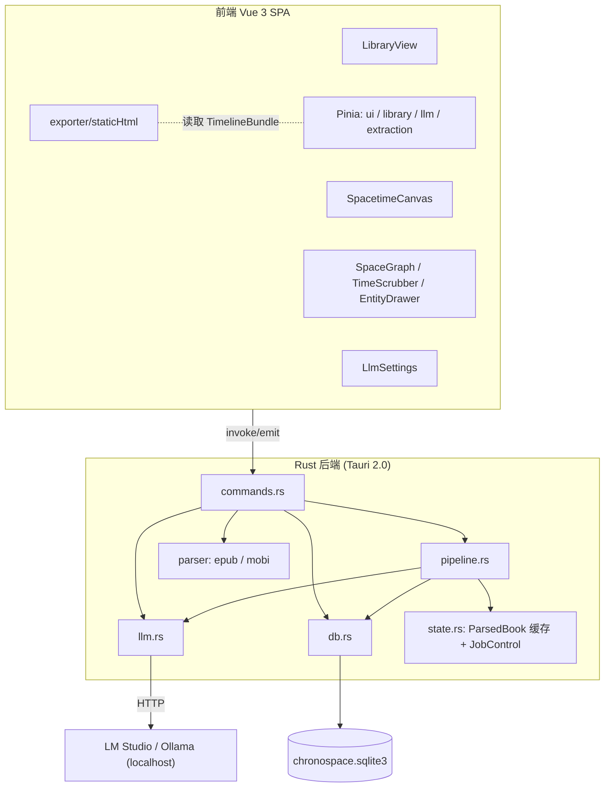
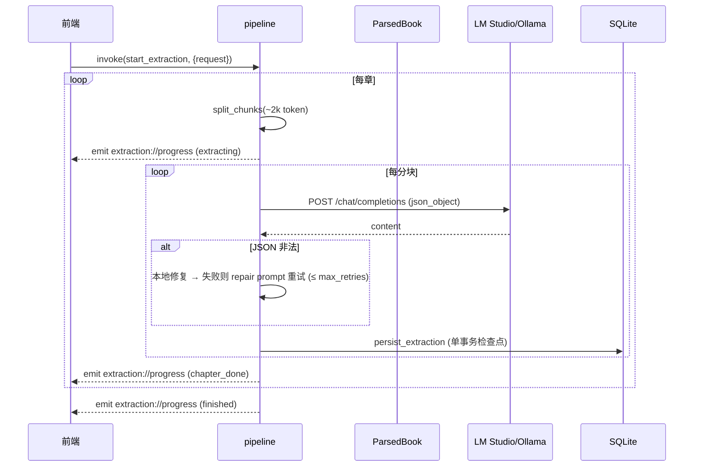
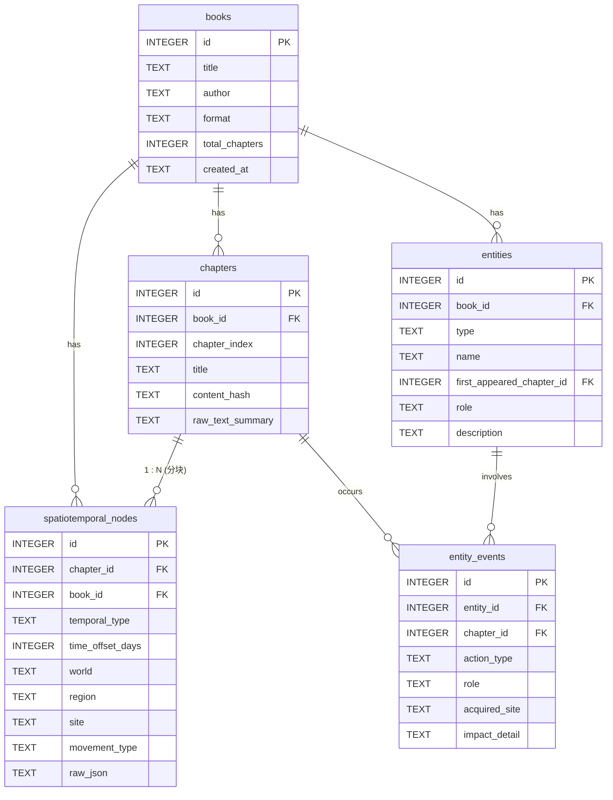
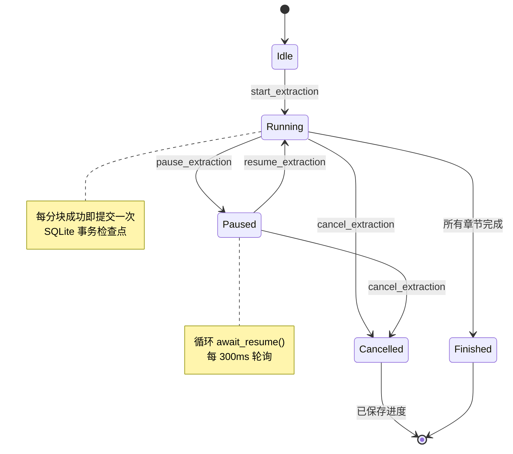

# ChronoSpace Reader · 架构设计蓝图（design.md）

> 当前版本：**v0.1.2**
> 本文档描述系统架构、数据流、SQLite 关系模式、状态机、协议契约与 UI 组件层级，并与代码库保持同步。

---

## 1. 设计目标与约束

| 目标 | 说明 |
| --- | --- |
| 本地优先 | 全部计算（解析、抽取、可视化、导出）在本机完成，不联网上传 |
| 内存解析 | 电子书原文仅驻留内存，结构化结果才落 SQLite，避免磁盘膨胀 |
| 本地 LLM | 通过 OpenAI 兼容协议对接 LM Studio / Ollama，强制 JSON 输出 |
| 结构可靠 | 严格 JSON Schema + 本地修复 + 有限次重试，容忍小模型输出抖动 |
| 可续跑 | 逐章事务检查点，支持暂停/继续/取消与断点续跑 |
| 可视化 | 拓扑空间图 + 双轴时间线 + 实体谱系 |
| 可发布 | 一键导出零依赖单页 HTML，适配 GitHub Pages |

**技术栈**：Tauri 2.0（Rust 2021）、Vue 3（`<script setup lang="ts">`）、Vite、Pinia、TailwindCSS、Font Awesome、Cytoscape.js、rusqlite（bundled）、reqwest（rustls）。

---

## 2. 分层架构



### 2.1 模块职责

| 模块 | 职责 |
| --- | --- |
| `parser/` | 格式探测、内存解析、分章、纯文本化（去标签、实体解码） |
| `llm.rs` | OpenAI 兼容客户端：模型探测、`chat/completions`、JSON 模式 |
| `pipeline.rs` | 分块、提示词、调用、JSON 修复与重试、事务持久化、进度事件 |
| `db.rs` | 迁移、CRUD、聚合查询（`timeline_bundle`） |
| `state.rs` | `ParsedBook` 内存缓存、`JobControl`（暂停/取消）、LLM 配置 |
| `commands.rs` | Tauri 命令边界，参数校验与错误映射 |

---

## 3. 数据流

### 3.1 导入（Ingest）

```mermaid
sequenceDiagram
  participant U as 用户
  participant FE as 前端
  participant CMD as commands.ingest_book
  participant PAR as parser
  participant DB as SQLite
  participant MEM as ParsedBook 缓存
  U->>FE: 拖入 / 选择文件
  FE->>CMD: invoke(ingest_book, {path})
  CMD->>CMD: tokio::fs::read(path) 读入内存
  CMD->>PAR: parse_book(filename, bytes)
  PAR->>PAR: detect_format → epub/mobi
  PAR-->>CMD: ParsedBook { chapters }
  CMD->>DB: insert_book / insert_chapter*
  CMD->>MEM: cache_book(book_id, ParsedBook)
  CMD-->>FE: IngestResult
```

### 3.2 抽取（Extract）



### 3.3 导出（Export）

前端读取 `timeline_bundle` → `exporter/staticHtml.ts` 生成内联 JSON 的单页 HTML → `plugin-dialog.save` + `plugin-fs.writeTextFile` 落盘。

---

## 4. SQLite 关系模式



- 唯一约束：`chapters(book_id, chapter_index)`、`entities(book_id, type, name)`。
- 外键均带 `ON DELETE CASCADE`（`entities.first_appeared_chapter_id` 为 `SET NULL`）。
- `PRAGMA journal_mode=WAL`、`foreign_keys=ON`、`synchronous=NORMAL`。
- 迁移策略：全部语句使用 `CREATE TABLE IF NOT EXISTS` / `CREATE INDEX IF NOT EXISTS`，可幂等重复执行。
- 一个章节可对应**多个** `spatiotemporal_nodes`（分块抽取），画布查询取每章最早节点作为代表。

---

## 5. 抽取 JSON Schema 契约（v1）

每个分块的模型输出必须是如下 JSON 对象（与 `models.rs::SegmentExtraction`、`types/schema.ts` 一一对应）：

```json
{
  "chapter_index": 12,
  "chapter_title": "七玄深谷",
  "narrative_perspective": "first_person",
  "temporal": {
    "type": "CONTINUOUS | JUMP_FORWARD | FLASHBACK | UNCERTAIN",
    "raw_marker": "三年后 / 眨眼数日",
    "relative_delta_days": 1095,
    "reference_anchor": "上一事件描述"
  },
  "spatial": {
    "world": "人界",
    "region": "越国",
    "site": "神手谷",
    "movement_type": "STAY | LOCAL_MOVE | TELEPORT | ASCENSION | DUNGEON_ENTER | DUNGEON_EXIT",
    "source_site": "七玄门宗门广场"
  },
  "characters": [
    { "name": "墨大夫", "action": "FIRST_APPEARANCE | ACTIVE | DEPARTURE | DEATH", "role": "师尊/对手", "description": "面色青黄的老者" }
  ],
  "items_and_skills": [
    { "name": "掌天瓶", "category": "ITEM | SKILL | LEGACY", "acquired_from": { "spatial": "神手谷后山草丛", "temporal": "入夜时分" }, "usage_in_chapter": "拾取并藏匿", "future_hook_flag": true }
  ],
  "plot_summary": "一句话核心剧情摘要"
}
```

**鲁棒性策略**（`pipeline::parse_extraction`）：

1. `extract_json_block`：截取首个 `{` 到末个 `}`，容忍前后缀文本与 Markdown 代码块。
2. `repair_json_text`：剔除 `/* */` 与 `//` 注释、去除尾随逗号。
3. `normalize_value`：补齐缺失数组、剔除缺 `name` 的条目。
4. 严格反序列化失败时 `lenient_extraction` 兜底，保留可识别字段。
5. 仍失败则携带错误与上一次输出，用修复提示词让模型重试，次数 = `LlmConfig.max_retries`（默认 3）。

**视角归一化**：系统提示词要求判断 `first_person` / `third_person`；第一人称时把「我」解析为主角规范名，无法确定则使用 `PROTAGONIST_FIRST_PERSON` 并在 `description` 注明别名。

---

## 6. IPC 协议契约（Tauri Commands）

| 命令 | 入参 | 出参 | 说明 |
| --- | --- | --- | --- |
| `ingest_book` | `path: string` | `IngestResult` | 读文件入内存并解析落库 |
| `list_books` | — | `BookRow[]` | 书库列表（含抽取进度） |
| `get_timeline` | `bookId: number` | `TimelineBundle` | 画布聚合数据 |
| `delete_book` | `bookId: number` | `void` | 级联删除 |
| `save_llm_config` | `config: LlmConfig` | `void` | 写入状态与磁盘 |
| `get_llm_config` | — | `LlmConfig \| null` | 读取配置 |
| `list_models` | `config: LlmConfig` | `ModelInfo[]` | `/v1/models`（Ollama 回退 `/api/tags`） |
| `test_connection` | `config: LlmConfig` | `boolean` | 连通性探测 |
| `start_extraction` | `request: ExtractionRequest` | `ChapterExtractionResult[]` | 批量抽取 |
| `pause_extraction` / `resume_extraction` / `cancel_extraction` | `bookId: number` | `void` | 任务控制 |
| `read_text_file` | `path: string` | `string` | 辅助读取 |

> Tauri v2 自动将 JS 侧 `camelCase` 参数映射为 Rust `snake_case`。

### 6.1 事件契约（后端 → 前端 emit）

- `extraction://progress` → `ProgressEvent { book_id, phase, current, total, chapter_index, chapter_title, message, retries }`
  - `phase ∈ { extracting, paused, skipped, chapter_done, finished, cancelled }`
- `extraction://log` → `string`（人类可读日志行）

### 6.2 错误契约

所有命令返回 `Result<T, AppError>`，`AppError` 序列化为：

```json
{ "code": "LLM_ERROR", "message": "无法连接引擎 http://localhost:1234/v1/models: ..." }
```

`code ∈ { DB_ERROR, PARSE_ERROR, UNSUPPORTED_FORMAT, LLM_ERROR, JSON_REPAIR_ERROR, IO_ERROR, SERDE_ERROR, INTERNAL_ERROR }`。

---

## 7. 抽取管线状态机



`JobControl` 以 `AtomicBool`（`paused` / `cancelled`）实现，注册于 `AppState.jobs`，任务结束后清除。

---

## 8. 前端状态与组件层级

```
App.vue
├── header (导航 + 引擎状态)
├── Sidebar.vue              书库列表 / 抽取进度
├── main
│   ├── LibraryView.vue      导入区 · 统计 · ExtractionRunner · 藏书卡片(导出/删除)
│   │   └── ExtractionRunner.vue   开始/暂停/继续/取消 · 进度条 · 日志
│   ├── SpacetimeCanvas.vue
│   │   ├── SpaceGraph.vue          Cytoscape 拓扑空间图 + 主角令牌动画
│   │   ├── TimeScrubber.vue        章节轴 + 虚拟时间线双滑块
│   │   └── EntityDrawer.vue        人物 / 物品功法 谱系抽屉
│   └── LlmSettings.vue       引擎选择 · 模型探测 · 参数 · 连接测试
└── ToastHost.vue             全局通知
```

### Pinia Store

| Store | 关键状态 | 关键动作 |
| --- | --- | --- |
| `ui` | `activeView`, `toasts` | `setView`, `toast`, `dismiss` |
| `library` | `books`, `activeBookId`, `timeline` | `refresh`, `ingest`, `open`, `reloadTimeline`, `remove` |
| `llm` | `config`, `models`, `connected` | `applyEngine`, `load`, `persist`, `fetchModels`, `test` |
| `extraction` | `running`, `paused`, `progress`, `logs`, `results` | `attach`, `start`, `pause`, `resume`, `cancel` |

---

## 9. 静态 HTML 导出器

`exporter/staticHtml.ts::buildStaticHtml(bundle)` 生成单文件：

- 内联 `TimelineBundle` JSON（`<` / `-->` 转义，避免脚本注入）。
- 通过 CDN 引入 Cytoscape.js，其余样式与逻辑全部内联（无其他外部依赖）。
- 视图：拓扑空间图（按 `world` 复合分组）+ 章节/虚拟时间双滑块 + 人物/物品谱系侧栏。
- 点击实体追溯其事件章节，并聚焦/高亮对应空间节点。

---

## 10. 错误处理与降级

| 场景 | 处理 |
| --- | --- |
| 无法识别格式 | `UNSUPPORTED_FORMAT`，提示仅支持 EPUB/MOBI/AZW3 |
| DRM / HUFF-CDIC | `UNSUPPORTED_FORMAT`，明确提示不支持 |
| 模型输出非法 JSON | 本地修复 → 修复提示词重试（≤3） → `JSON_REPAIR_ERROR` |
| 引擎不支持 `response_format` | 自动降级为不带该字段重试一次 |
| 引擎不可达 | `LLM_ERROR`，提示启动本地服务 |
| 抽取中断/取消 | 已完成章节的事务检查点保留，可续跑 |
| 非 Tauri 环境 | 前端 `api` 层守卫，返回明确错误提示 |

---

## 11. 版本与文档同步规则

- 版本源：`package.json`、`src-tauri/Cargo.toml`、`src-tauri/tauri.conf.json`。
- `scripts/bump-version.mjs` 同步三处并替换文档中的 `vX.Y.Z`。
- `scripts/docs-check.mjs` 校验一致性（可接入 CI）。
- 每个有意义的功能/修复递增 **PATCH**，提交遵循 **Conventional Commits**：

```
feat(core): implement epub parser in memory and sqlite schema v0.1.1
feat(llm): add lm studio open-ai compatible client with retry v0.1.2
feat(export): generate standalone single-page html bundle v0.1.3
docs: update README.md and design.md for spatiotemporal pipeline v0.1.4
```

---

## 12. 后续演进（Roadmap）

- HUFF/CDIC 与常见 DRM-free 变体解析。
- 每分块独立时空节点在画布上的分段轨迹渲染。
- 实体消歧（别名合并）与关系图（人物-人物连线）。
- 抽取原文持久化策略（可选压缩落盘）与会话恢复。
- Web Worker / 流式 UI 更新与增量导出。
